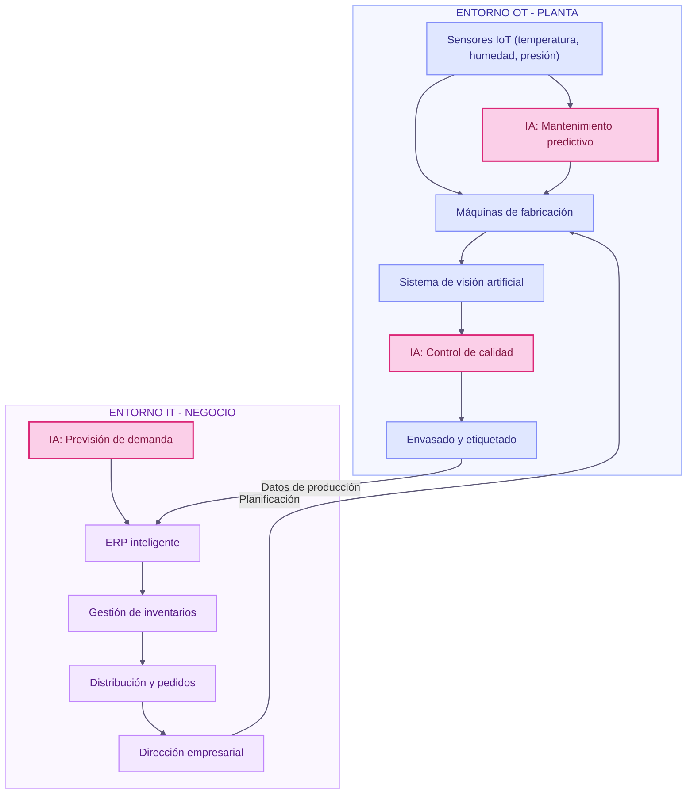
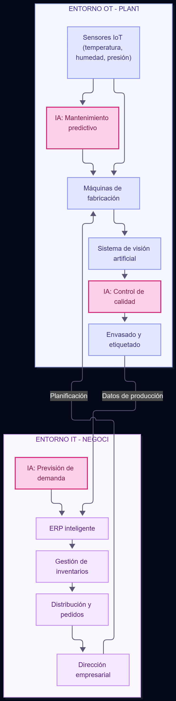

# Diagrama Mermaid
Diagrama de la estructura de la empresa. Separa el entorno **OT** (planta) del entorno **IT** (negocio) y muestra dónde actúa la inteligencia artificial.

**Leyenda de colores**
- Azul: elementos de planta (OT).
- Lila: elementos de negocio (IT).
- Rosa: componentes de IA.
 

> Si el diagrama no se renderiza, consulta la imagen.

---

## Relación entre IT y OT

El diagrama se organiza en dos entornos conectados por dos flujos:

- **De OT a IT: datos de producción.** Desde *Envasado y etiquetado*, la planta envía al *ERP inteligente* la información real de lo que se ha fabricado. Así, el negocio trabaja con datos actualizados.
- **De IT a OT: planificación.** Desde *Dirección empresarial*, las decisiones y los planes de producción vuelven a *Máquinas de fabricación*, que ajustan su actividad a lo que el negocio necesita.

Esta conexión es lo que permite la digitalización: la planta y el negocio dejan de funcionar como sistemas aislados.

## Dónde actúa la IA

| Entorno | Componente de IA | Qué aporta |
|---|---|---|
| OT | Control de calidad | Analiza las imágenes del sistema de visión artificial y detecta defectos antes del envasado. |
| OT | Mantenimiento predictivo | Usa los datos de los sensores IoT para anticipar averías en las máquinas y evitar paradas. |
| IT | Previsión de demanda | Alimenta al ERP con estimaciones de ventas, de modo que la planificación y los inventarios se ajusten a la demanda real. |

## Impacto organizacional

- **En planta:** los sensores y la visión artificial generan datos de forma continua. La IA convierte esos datos en decisiones: rechazar un producto defectuoso o programar una intervención en una máquina.
- **En negocio:** el ERP centraliza la información de producción, la gestión de inventarios y la distribución. La previsión de demanda reduce el exceso o la falta de stock.
- **En la organización:** la planificación deja de ser un proceso aislado de dirección y pasa a basarse en datos reales de planta, con un ciclo continuo de información entre ambos entornos.